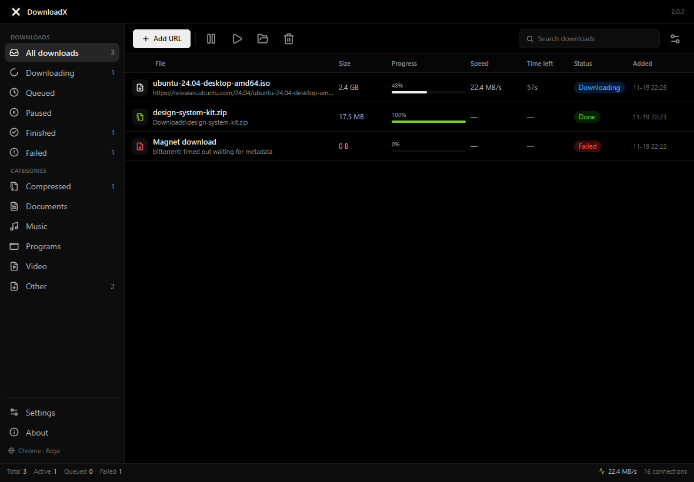
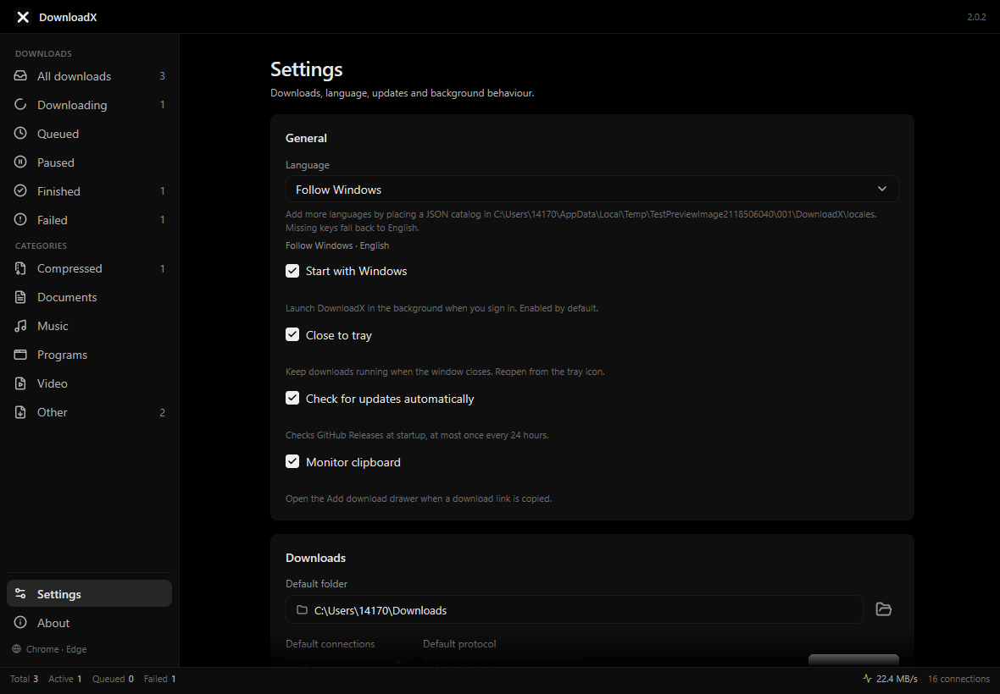

# DownloadX

**Fast, multi-connection download manager with a native Windows desktop app, written in Go.**

[](https://github.com/neko233-com/DownloadX/releases)
[](#install)
[](LICENSE)

DownloadX is an NDM-style downloader: HTTP(S) and FTP transfers are split into
16 parallel ranges by default, progress is checkpointed to disk, and interrupted
downloads resume where they stopped. It also handles HLS, DASH, and
BitTorrent — from one CLI or one native window.

> **Platform support:** Windows 10/11 x64 only, for now. Releases ship as an MSI.
> Linux and macOS are not supported yet. This repository does **not** use GitHub
> Actions; releases are built and tagged manually.



## Features

- **16 parallel connections** per download (`-x`, up to 128), adaptive segment
  count for small files, and a 512 KiB minimum segment size.
- **Resume anything**: per-segment checkpoints survive crashes, Ctrl+C and
  reboots. Changed remote files are detected through size, ETag,
  Last-Modified or FTP `MDTM`.
- **HTTP/HTTPS** with redirects, custom headers, cookies, basic auth, proxies,
  speed limits, and automatic fallback when a server ignores `Range`.
- **FTP/FTPS** with EPSV/PASV, `SIZE`/`MDTM`, `REST`-based segmented transfers,
  explicit TLS (`ftps://`), and single-stream fallback.
- **HLS VOD** with master-playlist variant selection, AES-128, `EXT-X-MAP`,
  `EXT-X-BYTERANGE`, concurrent segments and part-file resume.
- **DASH static** with SegmentTemplate/Timeline/List/Base, highest-bandwidth
  video + audio, optional `ffmpeg` muxing, and DRM detection.
- **BitTorrent** magnets, `.torrent` files and `.torrent` URLs, DHT, piece-level
  resume and optional seeding.
- **Native NDM-style workbench** built with [MyGo](https://github.com/egoist/mygo)
  and [Lobe MyGo](https://github.com/lobehub/lobe-mygo): category sidebar,
  toolbar, sortable download table, status bar and an Add Download drawer.
  GPU-drawn, no webview, no HTML, no JavaScript.
- **Pause, resume and queue**: pause keeps partial files, resume continues from
  the same byte offsets, and two downloads run at once by default.
- **Background operation**: closing the window keeps downloads running in the
  tray. The tray menu can open the app, pause/resume everything, toggle
  start-with-Windows, check for updates or quit.
- **Start with Windows** is enabled by default and can be switched off in
  Settings or from the tray menu.
- **Native i18n**: English, Simplified Chinese, Traditional Chinese, Japanese,
  German and French ship with the app. It follows the Windows display language
  on first launch; add more languages by dropping JSON catalogs into
  `%LOCALAPPDATA%\DownloadX\locales` — no rebuild required.
- **Built-in updater**: checks GitHub Releases at startup (at most once every
  24 hours), or on demand from Settings; downloads and verifies the MSI, then
  installs it through Windows Installer.
- **Chrome + Edge extension**, registered by the MSI through the browsers'
  external-extension registry and auto-updated from a self-hosted manifest — no
  Web Store, no developer mode.
- **Pure Go, no cgo.** The only non-stdlib downloader dependency is
  `anacrolix/torrent`, for BitTorrent.

## Install

### One line (PowerShell)

```powershell
irm https://raw.githubusercontent.com/neko233-com/DownloadX/main/install.ps1 | iex
```

The script downloads the latest MSI, asks Windows for administrator permission,
and installs to `C:\Program Files\DownloadX`. Launch **DownloadX** from the Start
menu, or run the CLI at `C:\Program Files\DownloadX\downloadx.exe`.

The desktop app starts with Windows by default, keeps running in the tray when
its window closes, and checks for updates automatically. Both behaviours can be
changed under **Settings → General**.

**Restart Chrome and Edge once after installing.** The MSI registers the
extension with both browsers' external-extension registry. Chrome and Edge show
a one-time **Keep extension** confirmation for self-hosted extensions; after
that, DownloadX is enabled and updates itself without the Web Store.

### One line (Git Bash, MSYS, Cygwin, WSL with Windows interop)

```sh
curl -fsSL https://raw.githubusercontent.com/neko233-com/DownloadX/main/install.sh | sh
```

### MSI directly

Download **DownloadX-windows-amd64.msi** from
[Releases](https://github.com/neko233-com/DownloadX/releases/latest) and open it.
The installer is per-machine (UAC prompt), installs the CLI, desktop app and
native messaging host, adds a Start-menu shortcut, and registers the Chrome/Edge
external extension.

### Browser extension

The MSI writes the browsers' external-extension registry keys with an
`update_url` pointing at this repository (no Web Store):

```
https://cdn.jsdelivr.net/gh/neko233-com/DownloadX@main/docs/extension/updates.xml
```

- Chrome and Edge install it on their next start after the MSI.
- Because it is self-hosted, each browser shows a one-time **Keep extension**
  confirmation on unmanaged Windows. Click it once per browser; this is the
  browser's security requirement, not a DownloadX prompt.
- The popup has an intercept toggle, a native-host status light and an
  "Open DownloadX" button.
- New browser downloads are cancelled and handed to the desktop app through
  `downloadx-host.exe` and `%LOCALAPPDATA%\DownloadX\inbox`.
- Right-click a link → **Download with DownloadX** also works.
- Updates are browser-managed: bump the extension version, run
  `scripts\build-extension.ps1`, commit `docs/extension/`, and upload the CRX to
  the release. The update URL stays stable.

Extension ID: `pdlpjmbjgipkbjekncinhchgbahpgbng`. The signing key is local
(`extensions/downloadx.pem`, untracked); see `extensions/README.md`.

### Build from source

Go **1.27.3 or later** is required because of MyGo.

```powershell
git clone https://github.com/neko233-com/DownloadX
cd DownloadX
go build -o downloadx.exe ./cmd/downloadx
go build -tags=mygo_nowebview -ldflags "-H=windowsgui" -o downloadx-gui.exe ./cmd/downloadx-gui
```

`-H=windowsgui` makes the desktop app a graphical Windows binary, so opening it
does not flash a console window. `mygo_nowebview` removes WebView2 code from
the Windows build, which also avoids antivirus heuristics on unsigned
executables.

## CLI

```powershell
downloadx [flags] <url|magnet:...|file.torrent>...
downloadx gui
downloadx version
downloadx help
```

```powershell
# 16 connections, inferred file name
downloadx https://releases.ubuntu.com/24.04/ubuntu-24.04-desktop-amd64.iso

# 32 connections, explicit output, speed limit
downloadx -x 32 -o ubuntu.iso --limit 20M https://example.com/ubuntu.iso

# Resume an interrupted download (same command)
downloadx -x 32 -o ubuntu.iso https://example.com/ubuntu.iso

# Batch from a file, one source per line
downloadx -d $HOME\Downloads -i urls.txt

# HLS VOD, best variant
downloadx https://example.com/vod/master.m3u8

# DASH static
downloadx https://example.com/stream/manifest.mpd

# BitTorrent
downloadx "magnet:?xt=urn:btih:0123456789abcdef0123456789abcdef01234567"
downloadx .\debian.torrent

# Machine-readable progress
downloadx --json https://example.com/file.zip
```

### Flags

| Flag | Meaning |
| --- | --- |
| `-o, --output PATH` | Output file (single source) or directory |
| `-d, --dir DIR` | Destination directory (default `.`) |
| `-x, --connections N` | Parallel connections per download (default 16, max 128) |
| `-i, --input FILE` | Read sources from a file (`#` comments allowed) |
| `-H, --header "K: V"` | Extra HTTP header (repeatable) |
| `--cookie VALUE` | Cookie header |
| `--referer URL` | Referer header |
| `--user-agent STR` | User-Agent (default `DownloadX/<version>`) |
| `-u, --user USER:PASS` | HTTP basic auth / FTP login |
| `--proxy URL` | `http`, `https` or `socks5` proxy |
| `--retry N` | Retries per segment or part (default 3) |
| `--timeout DUR` | Dial and response-header timeout (default 30s) |
| `--limit RATE` | Speed limit per task, e.g. `5M`, `800K` |
| `--type TYPE` | `auto`, `http`, `ftp`, `hls`, `dash`, `bt` |
| `--no-resume` | Discard resume state and start over |
| `--insecure` | Skip TLS certificate verification |
| `--json` | JSON-lines progress on stdout |
| `-q, --quiet` | No progress output |
| `--hls-quality Q` | `best`, `worst`, or a 0-based variant index |
| `--bt-port PORT` | BitTorrent listen port (0 = random) |
| `--seed` | Keep seeding after a torrent completes |
| `--ffmpeg PATH` | ffmpeg binary for DASH audio/video muxing |
| `-v, --version` | Print version |
| `-h, --help` | Print help |

Exit codes: `0` success, `1` failure, `2` usage, `130` interrupted.

### Resume state

- HTTP/FTP: `<output>.downloadx` stores the URL, size, validators and per-segment
  offsets. It is deleted after a successful download.
- HLS/DASH: `<output>.parts/` holds atomically written segment files plus a
  manifest; a changed playlist discards the old parts.
- BitTorrent: the data directory keeps piece completion, so re-running the same
  command resumes automatically.

DownloadX never silently overwrites an unrelated file. Auto-named downloads get
a `name (1).ext` suffix; an explicit `-o` that already exists without resume
state is an error (use `--no-resume` to overwrite).

## Desktop app

```powershell
downloadx-gui      # or: downloadx gui
```

The window is drawn natively on the GPU by MyGo, using Lobe MyGo components and
design tokens. There is no webview and no front-end build.

- **Category sidebar**: All downloads, Downloading, Queued, Paused, Finished,
  Failed, plus Compressed, Documents, Music, Programs, Video and Other.
- **Toolbar**: Add URL, Pause all, Resume all, Open folder, Clear finished and
  search; the update indicator appears when a release is available.
- **Download table**: file name and URL, size, progress, speed, time left,
  status and date added. Click a column to sort, right-click a row for pause,
  resume, retry, open, copy URL or remove.
- **Status bar**: totals, active/queued/failed counts, aggregate speed and
  connection count.
- **Add Download drawer**: URL, folder, optional file name, connections and
  protocol. Press Enter in the URL field or click **Start download**.
- **Settings**: follow-Windows language selection, start with Windows, close to
  tray, automatic update checks, clipboard monitoring, default folder,
  connections and protocol.
- **Updates**: manual **Check now**, automatic startup checks, release notes,
  download progress, checksum verification and **Install and restart**.
- **Tray**: open the app, pause/resume all, toggle start with Windows, check for
  updates or quit. Closing the window keeps downloads running.
- Two downloads run at once; the rest wait in the queue. Pause keeps partial
  files and resume continues from the same offsets.
- Progress updates include speed, ETA, segment counts and torrent peers.
- Settings persist to `%LOCALAPPDATA%\DownloadX\settings.json`.

| Downloads | Settings |
| --- | --- |
|  |  |

Light previews: [downloads](docs/gui-preview-light.png) ·
[settings](docs/gui-preview-settings-light.png).

### Languages

English, Simplified Chinese, Traditional Chinese, Japanese, German and French
ship with the app. It follows the Windows display language on first launch;
pick a fixed language under **Settings → General → Language**.

To add a language without rebuilding, drop a JSON catalog into
`%LOCALAPPDATA%\DownloadX\locales` (for example `ko.json`):

```json
{
  "name": "한국어",
  "messages": {
    "nav.downloads": "다운로드",
    "nav.settings": "설정",
    "nav.about": "정보",
    "toolbar.add": "URL 추가",
    "category.all": "모든 다운로드"
  }
}
```

Missing keys fall back to English. The file name (`ko`) is the language code
shown to the app; the `name` is what Settings displays.

## Protocol support

| Source | Status | Notes |
| --- | --- | --- |
| HTTP / HTTPS | Stable | Range segments, resume, redirects, auth, cookies, proxy, speed limit, Range-less fallback |
| FTP / FTPS | Stable | EPSV/PASV, `SIZE`/`MDTM`, `REST` segments, explicit TLS, fallback without `REST` |
| HLS (VOD) | Stable | Master playlists, AES-128, `EXT-X-MAP`, byte ranges, concurrent segments |
| DASH (static) | Stable | SegmentTemplate, SegmentTimeline, SegmentList, SegmentBase; audio/video muxing with ffmpeg |
| BitTorrent | Stable | Magnet, `.torrent` file/URL, DHT, resume, optional seeding |

### Known limitations

- Windows only for now; Linux and macOS builds are not shipped or supported.
- HLS **live** playlists and SAMPLE-AES/DRM streams are refused.
- DASH **dynamic** manifests and DRM (`ContentProtection`) are refused; only
  the first `Period` is downloaded.
- Separate DASH audio and video are muxed with `ffmpeg` when it is available.
  Otherwise two files are kept and the window/CLI tells you so.
- `ftps://` means explicit TLS (`AUTH TLS`); implicit FTPS and SFTP are not
  supported.
- BitTorrent v2-only torrents are not guaranteed; v1 and hybrid torrents work.
- The MSI and executables are unsigned. Windows may show an unknown-publisher
  or SmartScreen prompt on first run; choose **More info → Run anyway**. The
  published SHA-256 checksums can be verified against the release assets.
- Self-hosted browser extensions need one **Keep extension** confirmation per
  browser on unmanaged Windows. That is a browser security rule, not a
  DownloadX prompt.

## Manual releases

There is no CI/CD. Tags and GitHub releases are created by hand. See
[RELEASE.md](RELEASE.md) for the checklist. In short:

```powershell
powershell -ExecutionPolicy Bypass -File scripts\build-extension.ps1
powershell -ExecutionPolicy Bypass -File scripts\build-msi.ps1 -Version 2.0.2
git tag -a v2.0.2 -m "DownloadX 2.0.2"
git push origin v2.0.2
gh release create v2.0.2 dist\DownloadX-windows-amd64.msi dist\DownloadX-windows-amd64.msi.sha256 dist\DownloadX-extension.crx dist\DownloadX-extension.crx.sha256
```

The build scripts produce `dist\DownloadX-windows-amd64.msi` and
`dist\DownloadX-extension.crx` with stable asset names. The install scripts use
`releases/latest/download/DownloadX-windows-amd64.msi`; browsers use the
jsDelivr copy of `docs/extension/updates.xml` and `downloadx.crx`. Commit the
refreshed `extensions/updates.xml` and `docs/extension/`, push, then run
`scripts\purge-cdn.ps1` so browsers see the new extension immediately. The MSI
build requires Go 1.27.3+ and WiX Toolset 3.14 (`candle.exe`, `light.exe`).

## Architecture

```
cmd/downloadx              CLI entrypoint
cmd/downloadx-gui          native desktop entrypoint
cmd/downloadx-host         browser native messaging host
internal/cli               argument parsing, run loop
internal/runner            protocol detection and dispatch
internal/httpdl            segmented HTTP(S) downloader
internal/ftp               FTP/FTPS client and segmented downloader
internal/hls               HLS playlist parser and downloader
internal/dash              MPD parser and downloader
internal/segdl             concurrent part download + ordered concat
internal/bt                anacrolix/torrent adapter
internal/engine            task model, naming, resume state, rate limiter
internal/progress          TTY / plain / JSON progress reporters
internal/desktop           NDM workbench, tray, queue manager, updater UI
internal/desktop/assets    title-bar, About and tray logo PNGs
internal/desktop/i18n      JSON language catalogs and language matching
internal/update            GitHub Releases check, checksum and MSI install
internal/inbox             browser-to-desktop request queue
.agents/skills             MyGo agent skills installed with `mygo install-skills`
extensions/downloadx       Chrome/Edge MV3 extension
installer/                 WiX source, native host manifest, icon and license
scripts/build-msi.ps1      Windows MSI build
scripts/build-extension.ps1 CRX pack + update manifest
install.ps1, install.sh    one-line installers
docs/extension/            self-hosted CRX + updates.xml for browsers
```

## Development

```powershell
go vet ./...
go test ./...          # local HTTP/FTP/HLS/DASH/BitTorrent tests
```

GUI previews can be rendered without opening a window:

```powershell
$env:DOWNLOADX_PREVIEW="$PWD\docs\gui-preview.png"
go test ./internal/desktop -run TestPreviewImage -v
```

## License

[MIT](LICENSE)
